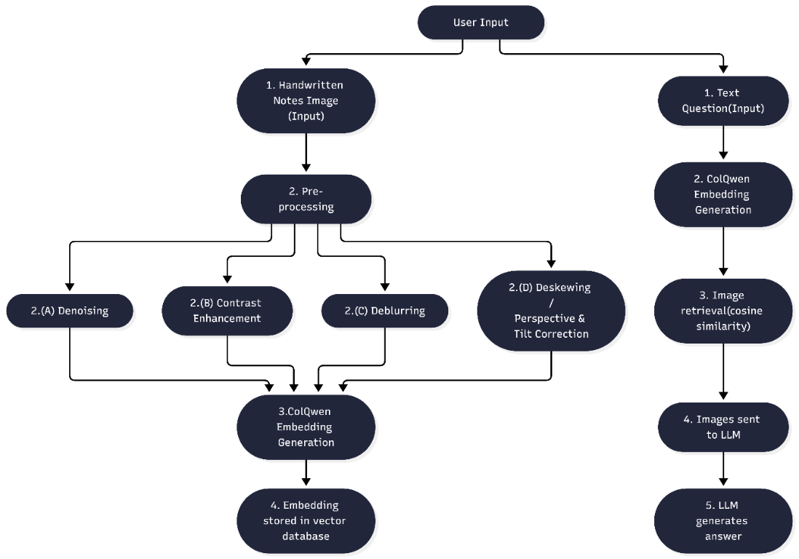
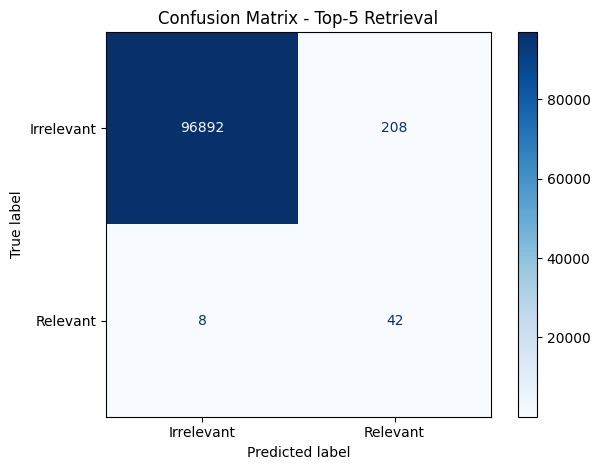
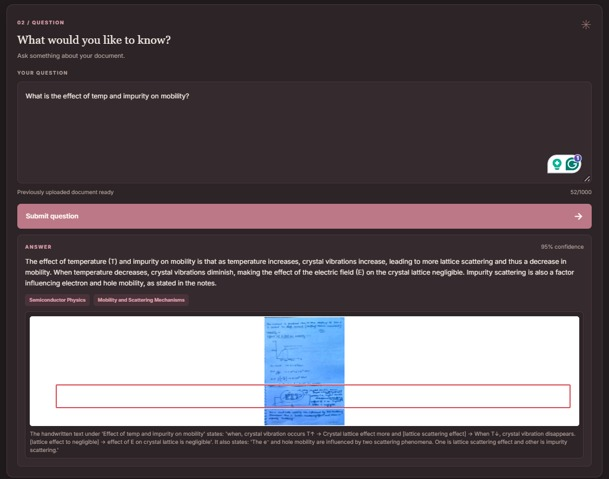
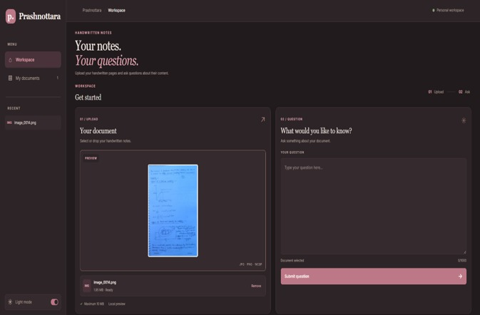
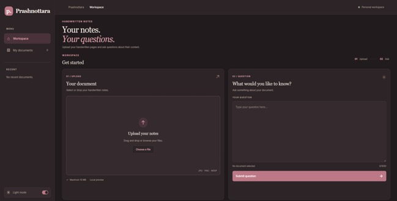

# Handwritten Notes AI - Backend API

The `handwritten-api` is the FastAPI backend for a handwritten-notes question
answering system. It accepts notebook images and questions, detects and cleans
the note pages, converts them into searchable vector representations, retrieves
the pages that are most relevant to a question, and sends the retrieved images
to a vision language model to generate a grounded answer.

The backend supports account authentication, document indexing, semantic page
search, document and page management, and direct handwritten-image question
answering.

## Main Technologies

| Technology | Role |
| --- | --- |
| **Python and FastAPI** | REST API, validation, routing, authentication, and asynchronous endpoints |
| **Uvicorn** | ASGI development and production server |
| **YOLO / Ultralytics** | Detects and crops the handwritten page from an uploaded image |
| **OpenCV** | Denoising, contrast enhancement, sharpening, and image cleanup |
| **Pillow and NumPy** | Image decoding, conversion, resizing, and array processing |
| **Jina Embeddings v4** | Creates multimodal image and text multivectors for retrieval |
| **ColQwen2 legacy pipeline** | Older collection format retained for backwards-compatible reindexing |
| **Qdrant** | Stores and searches named multivectors using cosine similarity and MAX_SIM |
| **Supabase** | Authentication and persistent storage of processed page images |
| **Gemini Flash** | Default vision answer-generation provider |
| **Qwen3-VL on OpenRouter** | Optional multimodal Qwen answer-generation provider |
| **PyTorch** | Runs the locally loaded YOLO page detector |

## What the Project Does

1. Accepts one or more handwritten-page images and a natural-language question.
2. Validates the image type and size.
3. Detects the notebook page using YOLO segmentation.
4. Preprocesses the cropped page with OpenCV.
5. Generates a Jina Embeddings v4 multivector for the page or question.
6. Stores page embeddings and metadata in Qdrant and processed images in
   Supabase Storage.
7. Retrieves the top matching pages using cosine similarity and Qdrant
   MAX_SIM comparison.
8. Sends the retrieved page images and question to Gemini or Qwen3-VL.
9. Returns an answer generated only from the supplied note pages.

## Preprocessing Pipeline

The image pipeline is implemented in `app/services/page_detection.py` and
`app/services/pre_processing.py`.

### YOLO page detection

- The input image is converted to a NumPy array.
- The Ultralytics YOLO segmentation model from `models/best.pt` predicts masks.
- A confidence threshold of `0.5` is used with a `640` pixel inference size.
- The largest valid segmentation mask is selected.
- The bounding box of that mask is used to crop the handwritten page.
- The YOLO model is unloaded after processing to release memory.

### OpenCV preprocessing

The cropped page is processed before embedding or answer retrieval:

- Converted from RGB to BGR for OpenCV processing.
- Denoised with fast non-local means denoising.
- Converted to the LAB color space.
- Contrast Limited Adaptive Histogram Equalization (CLAHE) is applied to the
  luminance channel.
- A Gaussian blur is used to derive a sharpness difference.
- Sharpening is applied with a weighted unsharp-mask-style operation.
- The result is converted back to RGB and used for indexing or viewing.

Preprocessing makes the handwriting, equations, tables, and page layout more
consistent before Jina creates its visual representation.

## Embeddings, Vector Storage, and Retrieval

The project uses Jina Embeddings v4 for its current embedding format.
`app/services/embedding.py` generates:

- `retrieval.passage` embeddings for indexed page images.
- `retrieval.query` embeddings for natural-language questions.

Jina returns native multivectors rather than a single averaged vector. Jina
image patches and text vectors are therefore kept as matrices. The model output
is validated as a 128-dimensional vector matrix before storage.

Qdrant receives the named `jina_v4` vector and uses:

- **Cosine distance** for similarity.
- **MAX_SIM** to compare a question multivector with an image multivector.
- HNSW settings for indexed retrieval.
- Payload indexes for `document_id` and `notebook_id`.

The collection is named `handwritten_pages_jina` by default. The collection
dimension, float type, cosine distance, and MAX_SIM configuration are validated
before writes and searches. Processed PNG pages are stored in Supabase Storage;
Qdrant stores embeddings and metadata. This keeps retrieval persistent across
API restarts and allows stored pages to be returned for answer generation.

The system also contains a legacy ColQwen2 collection and reindex route. Existing
legacy embeddings can be read and their source images re-embedded with Jina
using `POST /api/documents/{document_id}/reindex`.

## Answer Generation with Gemini and Qwen

Answer generation uses `app/services/answer_service.py` to select the provider
configured by `LLM_PROVIDER`.

### Gemini Flash

Gemini is the default provider. It receives the retrieved PNG pages, the user
question, and a grounding prompt that:

- Treats the notes as the sole source of truth.
- Requires visual evidence from the supplied pages.
- Preserves terminology and equations.
- Instructs the model not to guess or add outside knowledge.
- Requests that missing evidence be stated explicitly.

The Gemini service uses temperature `0` and a maximum of `512` output tokens.

### Qwen3-VL through OpenRouter

Set `LLM_PROVIDER=openrouter` to generate answers with the configured
OpenRouter vision model, which defaults to `qwen/qwen3-vl-8b-instruct`.

The Qwen request contains:

1. The grounding instructions.
2. The exact user question.
3. Base64-encoded PNG versions of the retrieved note pages.

The model returns a structured JSON response containing the answer, subject
classification, confidence, evidence-found flag, evidence descriptions, and
normalized bounding boxes. The backend validates the result and attaches page
and document references to evidence locations.

The Qwen model does not perform vector storage or retrieval itself. Jina and
Qdrant select relevant pages first; Qwen/Gemini then reads only those selected
images and generates the answer.

## System Pipeline



The diagram shows both branches: image preprocessing and Jina indexing, and
question embedding followed by Qdrant retrieval and answer generation.

## Retrieval Result



The confusion matrix summarizes top-5 retrieval behavior: `96,892` irrelevant
items were correctly rejected, `208` irrelevant items were incorrectly
retrieved, `8` relevant items were missed, and `42` relevant items were
retrieved.

## UI/UX Samples

### Answer and evidence view



The answer interface shows the question, grounded text answer, confidence
state, retrieved source page, and controls for submitting another question.

### Workspace with document and questions



The workspace presents uploaded documents, the selected page, and the question
panel side by side.

### Document upload state



The upload area allows users to select a note page and starts the question
answering workflow.

## Project Structure

```text
handwritten-api/
├── app/
│   ├── main.py                 # FastAPI application and route registration
│   ├── routes/                 # Auth, answer, embedding, and document APIs
│   ├── services/               # YOLO, preprocessing, Jina, Qdrant, Qwen/Gemini
│   └── models/                 # Pydantic request and response schemas
├── assets/                     # README result and UI images
├── data/                       # Local document data
├── models/best.pt              # YOLO page-segmentation weights
├── requirements.txt            # Standard dependencies
├── requirements-gpu.txt        # CUDA-oriented dependencies
└── tests/                      # API tests
```

## Setup

Run all commands from `D:\capstone_application\handwritten-api`.

### 1. Create and activate a virtual environment

```powershell
python -m venv .venv
.\.venv\Scripts\Activate.ps1
```

### 2. Install dependencies

CPU or normal environment:

```powershell
python -m pip install --upgrade pip
pip install -r requirements.txt
```

For a CUDA-enabled NVIDIA environment:

```powershell
pip install -r requirements-gpu.txt
```

### 3. Configure environment variables

Create `.env` in the `handwritten-api` folder:

```dotenv
FRONTEND_ORIGIN=http://localhost:5173
PORT=3000

SUPABASE_URL=https://your-project.supabase.co
SUPABASE_PUBLISHABLE_KEY=your-publishable-key
SUPABASE_SERVICE_ROLE_KEY=your-service-role-key
SUPABASE_STORAGE_BUCKET=handwritten-files

JINA_API_KEY=your-jina-api-key
JINA_EMBEDDING_MODEL=jina-embeddings-v4
JINA_QDRANT_COLLECTION=handwritten_pages_jina

QDRANT_URL=https://your-cluster.qdrant.cloud
QDRANT_API_KEY=your-qdrant-api-key
QDRANT_COLLECTION=handwritten_pages

YOLO_MODEL_PATH=models/best.pt

# gemini or openrouter
LLM_PROVIDER=gemini
GEMINI_API_KEY=your-gemini-api-key
GEMINI_MODEL=gemini-3.8-flash

# Required only when LLM_PROVIDER=openrouter
OPENROUTER_API_KEY=your-openrouter-api-key
OPENROUTER_MODEL=qwen/qwen3-vl-8b-instruct
OPENROUTER_BASE_URL=https://openrouter.ai/api/v1
OPENROUTER_MAX_TOKENS=1024
OPENROUTER_TEMPERATURE=0.2

MAX_IMAGE_COUNT=5
MAX_IMAGE_SIZE_BYTES=10485760
```

Keep secret keys in `.env` and never expose `SUPABASE_SERVICE_ROLE_KEY`,
`JINA_API_KEY`, `QDRANT_API_KEY`, or provider API keys in frontend code.

Place the YOLO weights at `models/best.pt`, or set `YOLO_MODEL_PATH` to another
valid path.

## Run the Project

Start the FastAPI server with the required command:

```powershell
uvicorn app.main:app --reload
```

The API is normally available at `http://127.0.0.1:8000`. Interactive API
documentation is available at `http://127.0.0.1:8000/docs`.

The alternative `python -m app.main` entry point can also start the server,
using the `PORT` setting, but `uvicorn app.main:app --reload` is the standard
development command.

## API Overview

- `GET /health` - service health check.
- `POST /api/auth/signup` - create a Supabase account.
- `POST /api/auth/login` - obtain an access session.
- `GET /api/auth/me` - obtain the authenticated user.
- `POST /api/auth/logout` - revoke the authenticated session.
- `POST /api/handwritten/process` - authenticate, process images, and generate an answer.
- `POST /api/embeddings/image` - YOLO-crop and preprocess an image, then embed it.
- `POST /api/embeddings/question` - embed a question as a Jina multivector.
- `POST /api/documents/index` - index a page into Qdrant and Supabase Storage.
- `POST /api/documents/search` - search indexed note pages.
- `POST /api/documents/ask` - retrieve relevant pages and ask the selected vision model.
- `GET /api/documents/{document_id}/pages/{page_id}/image` - download a stored page.
- `POST /api/documents/{document_id}/reindex` - migrate legacy embeddings to Jina.
- `DELETE /api/documents/{document_id}` - remove document embeddings and page images.

Example direct handwritten request:

```bash
curl -X POST http://127.0.0.1:8000/api/handwritten/process \
  -H "Authorization: Bearer <access-token>" \
  -F "question=What are the effects of temperature and density on mobility?" \
  -F "images=@notebook-page.jpg"
```

Example document indexing and search:

```bash
curl -X POST http://127.0.0.1:8000/api/documents/index \
  -F "document=@notebook-page.jpg" \
  -F "notebook_id=physics-notes"

curl -X POST http://127.0.0.1:8000/api/documents/search \
  -H "Content-Type: application/json" \
  -d "{\"query\":\"What is mobility?\",\"top_k\":5}"
```
